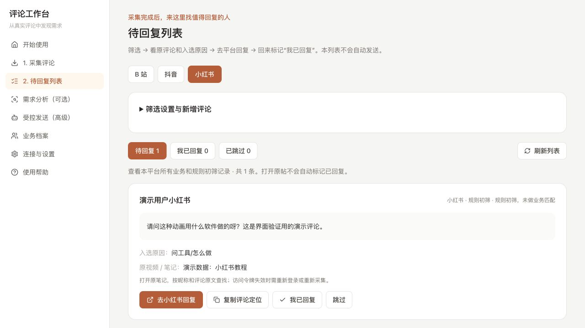
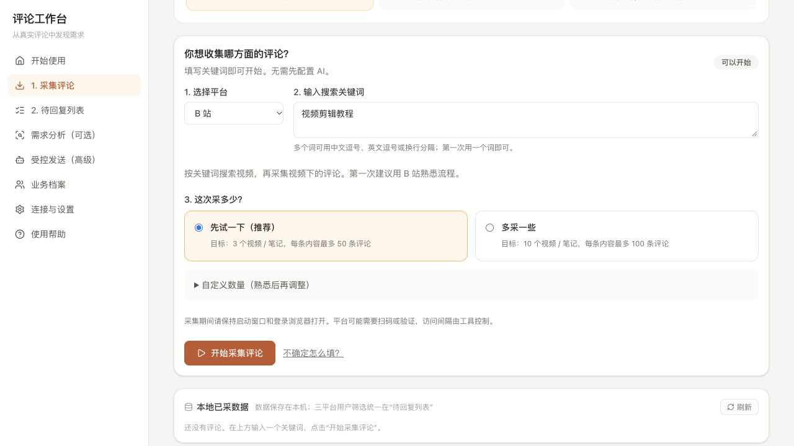
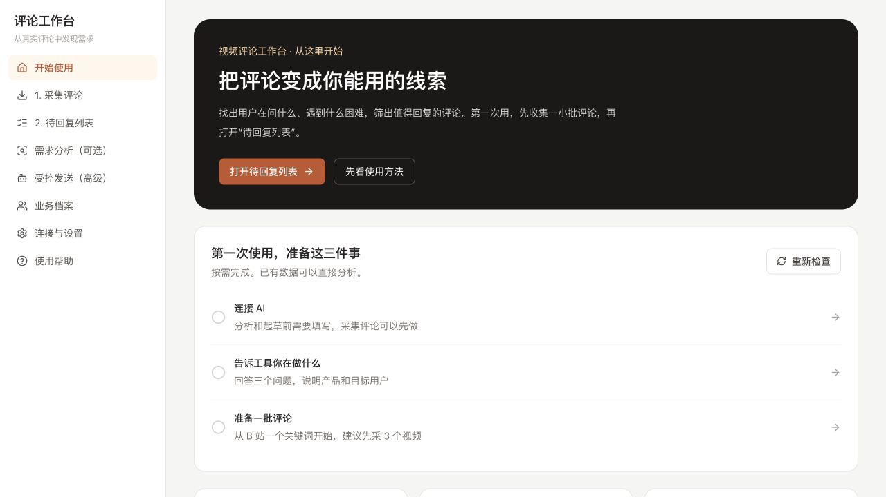

# 评论工作台

面向团队的多平台评论工具：**采集评论 → 筛选待回复列表 → 打开原帖人工回复 → 标记处理进度**。需要时可使用独立的 AI 起草与受控发送工具。

## 界面预览

以下是实际运行界面的截图。列表使用明确标注的演示评论，不包含真实用户数据或密钥。

### 最常用：看列表，去平台回复

在 B 站、抖音、小红书之间切换，查看**评论原文、入选原因和原帖**。点「去平台回复」，自己回复后再点「我已回复」；也可以跳过或恢复。



### 先采一小批，不用填复杂参数

选平台 → 输入关键词 → 保持「先试一下」→ 开始采集。下面的截图仅填写关键词，没有实际发起采集。



<details>
<summary>查看首页与第一次使用的准备指引</summary>

首页会检查 AI 配置、业务档案和本地评论，提示下一步该做什么；已有评论时可直接打开待回复列表。



</details>

## 功能

- **采集评论**：B 站、小红书、抖音等平台；支持链接、关键词、创作者内容扫描，以及本地数据预览/导出。YouTube 支持本地频道清单采集与任务进度。
- **分析与筛选用户**：评论证据分析、需求/意图分类、候选用户筛选、真实语料验证搜索场景、按产品隔离任务。
- **起草回复**：按产品事实和原评论起草，提供推荐与帮助两种模式、质检理由、图片附件；无法支撑的推荐弃写。
- **人工审核与发送**：逐条编辑、批准/拒绝后受控发送；保留每日上限、间隔、允许时段、去重、风控冷却和人工停采。
- **产品档案与设置**：建档、明确切换产品、回复口吻与禁区；独立模型设置、账号异常与费用统计。

## 给第一次使用的同事

日常最重要的页面是 **待回复列表**，B 站、抖音、小红书操作一致。

1. **采集评论**：选平台、输入关键词，先小批量采集。弹出官方登录页时扫码。
2. **待回复列表**：选相同平台，选择“AI 按业务匹配”及业务档案，点击“筛选待回复评论”。只筛人，不要求先生成回复草稿。
3. 看每条**昵称、评论原文、原视频/笔记、入选原因**，点“去 B 站 / 抖音 / 小红书回复”。在平台评论区自行找到对方并回复，可复制评论原文辅助查找。
4. 回列表点 **我已回复** 或 **跳过**，以后可恢复。打开原帖不会自动标记，标记也不代表平台已确认发送。

**三平台待回复列表已经接线实现，不是示意页面。** 数据来自本地实际采回的评论，按平台隔离；结果与处理状态持久化在 `data/manual_replies/`，与自动发送队列独立。抖音不使用 B 站评论锚点，小红书优先保留原链接的访问令牌；平台可能不支持准确定位到评论，界面会提示按昵称和原文查找。

没有 AI 密钥可选 **提问 / 求助规则初筛**，沿用现有问题与工具需求规则；结果明确标记为未完成业务匹配，不能当作 AI 筛出的目标客户。有密钥时先在“连接与设置”配置 AI，再通过“业务档案”回答三个问题。AI 不可用时明确报告失败，不把规则结果冒充业务匹配。

“需求分析”用于查看报告，“受控发送（高级）”保留原有人工审核、发送间隔与平台保护。**普通人工回复直接使用待回复列表，不需要开启自动发送。**

## 安装与启动

### 平时启动（同事使用）

- **Mac**：双击 `run.command`。
- **Windows**：双击 `run.bat`。
- **Linux / 终端**：运行 `./run_web.sh`。

等待提示「启动成功」，浏览器会自动打开 [评论工作台](http://127.0.0.1:8766)。**使用期间保留启动窗口，结束后按 Ctrl+C。** 不需要另外启动前端服务。重复启动时会提示端口已占用，不会结束已有进程。

从 GitHub 拉取源码后首次启动，会自动安装前端依赖并构建界面，需要网络和 Node.js。之后执行 `git pull --ff-only` 更新代码，再双击启动即可：启动器会检查源码内容变化并重建过期界面，不会继续使用旧页面。

### 第一次安装（维护者完成）

需要 **uv、Chrome/Chromium、Node.js 22.12+ 或 24.0+**。uv 会按项目 `.python-version` 准备 Python 环境。

- uv：[官方安装说明](https://docs.astral.sh/uv/getting-started/installation/)
- Node.js：[官方下载](https://nodejs.org/)

```bash
git clone https://github.com/xiaohuanglian/video-comment-analyzer.git
cd video-comment-analyzer
uv sync --frozen
uv run playwright install chromium
# Mac / Linux
./run_web.sh
# Windows 请双击 run.bat
```

Mac 提示无法执行时，在项目目录运行 `chmod +x run.command run_web.sh`。依赖下载失败时先检查网络，保留启动窗口的错误交给维护者。

### 直接从 GitHub 更新（维护者 / 已安装的电脑）

先退出工具，备份原来的 `data/` 和 `.env`，保留本机登录档案。然后在原项目目录执行：

```bash
git pull --ff-only
uv sync --frozen
```

再双击 Mac 的 `run.command` 或 Windows 的 `run.bat`。新版启动器自动检测并重建界面，无需另外开启前端。若 `git pull` 提示本地修改冲突，先保留本地改动并联系维护者，不要直接覆盖。

数据、密钥和登录状态不进 GitHub，因此同事在原项目中更新代码时仍使用他本机的数据；换新电脑则需要另行迁移数据及重新登录。

B 站使用已登录 Cookie；小红书和抖音的回复使用本机浏览器登录态。根评论发送只支持 B 站。登录、采集和发送是否可用以实际平台检查为准；平台异常时保留冷却，不自动重试解除。

## 配置与数据边界

- 模型配置位于本地 `data/model_settings.json`（权限 0600），API 只返回脱敏 Key。也支持 `.env` 的 `LLM_BASE_URL / LLM_API_KEY / LLM_MODEL`，环境变量优先。
- Base URL 填根地址，端点由统一解析器拼接，避免重复 `/v1`。
- 数据保存在本地 `data/`；`data/` 与 `docs/` 是独立本地仓库，无 remote、永不 push。`.env`、`browser_data/`、冷却记录均为本地状态，不随代码分发。
- API 无鉴权、仅供本机使用。不要把服务端口开放到公网。
- `/api/data/*` 使用目录白名单；凭据、回复队列与内部状态不可下载。
- AI 只发现与起草，人确认与发送。采集冷却、搜索配额、夜间静默及人工停采仍有效。

## 验证范围

三平台测试覆盖各自原生字段的 JSONL 采集数据读取、平台隔离、AI 业务筛选（使用模型替身）、无需 AI 的规则初筛、原帖回链、列表持久化、处理标记与重复筛选去重。前端测试覆盖三个平台的列表和按钮，以及不自动批准/发送。

这些测试不等于真实平台账号已通过验证：登录、实时采集、评论是否仍存在以及能否在原帖定位，仍以实际账号和平台页面为准。Windows 启动脚本尚需 Windows 实机验证。

## 开发

```bash
uv run pytest tests -q
uv run ruff check api tools scripts tests
cd web_react
npx tsc -b --noEmit
npx oxlint
npx vitest run
npm run test:node
npm run build
```

本地开发：运行 `./run_web_dev.sh` 启动后端，再在 `web_react` 运行 `npm run dev`，打开 `http://localhost:5173`。普通使用走单端口启动入口。

前端保持 Vitest 3。修改被 import 的后端模块后重启 Web 服务。

结构：`api/routers` 提供采集/分析/档案/回复/设置接口；`api/services/insight` 保留用户需求证据；`api/services/outreach` 负责筛选、起草与受控发送；`media_platform` 与 `tools` 提供采集及平台保护。

## 许可证

MIT。本项目派生自 [MediaCrawler](https://github.com/NanmiCoder/MediaCrawler)（MIT），保留其原始版权声明，详见 [THIRD_PARTY_NOTICES.md](THIRD_PARTY_NOTICES.md)。
